<div align="center">


# Hey, I'm Abdelrhman Mersal 🎏

### Full-Stack Software Developer · Software Engineer at **Octo**


<br />


</div>


## 🪷 About Me

```ts
const abdelrhman = {
  name: "Abdelrhman Mersal",
  title: "Full-Stack Software Developer",
  role: "Software Engineer at Octo",
  focus: [
    "SaaS Platforms",
    "Backend Systems",
    "Business Automation",
    "Dashboards",
    "Internal Tools",
    "Workforce Systems",
  ],
  mindset: "Build real products, solve real problems, keep systems clean.",
};
```



I build software for real problems — dashboards, backend systems, SaaS tools, automations, and internal platforms that help businesses run smoother.

I like turning messy workflows into clean products people actually enjoy using.

Still learning, still building, still trying to make every project better than the last. 🌱

<br clear="right" />


## 🌸 What I Build

<table>
  <tr>
    <td>🐟 SaaS platforms</td>
    <td>🫧 Workforce management systems</td>
  </tr>
  <tr>
    <td>🪷 Dashboards and admin portals</td>
    <td>🌊 Backend APIs and integrations</td>
  </tr>
  <tr>
    <td>🔐 Role-based permission systems</td>
    <td>🎐 Business automation tools</td>
  </tr>
  <tr>
    <td>🏮 Internal company systems</td>
    <td>🚀 Production-ready web applications</td>
  </tr>
</table>

## 🎏 Current Work

### Software Engineer — Octo

Working on production backend systems, APIs, Redis caching, permissions, integrations, internal tools, and business-critical features.


## 🍡 Tech Stack

### Backend

<p>
  
  
  
  
  
</p>

### Frontend

<p>
  
  
  
  
</p>

### DevOps & Tools

<p>
  
  
  
  
  
</p>


## ✨ GitHub Stats

<div align="center">


</div>

## 🫧 Contribution Pond

<div align="center">

<picture>
  <source media="(prefers-color-scheme: dark)" srcset="https://raw.githubusercontent.com/Mersal108/Mersal108/output/pond-snake-dark.svg" />
  <source media="(prefers-color-scheme: light)" srcset="https://raw.githubusercontent.com/Mersal108/Mersal108/output/pond-snake.svg" />
  
</picture>

</div>


## 🎐 How I Think About Software

I like building software that is:

- 🌱 Simple enough to use
- 🌊 Strong enough to scale
- 🧹 Clean enough to maintain
- 💖 Useful enough to matter

Good software should not just look good. It should make work easier, faster, and less chaotic.

## 💌 Connect

<p>
  <a href="https://www.linkedin.com/in/abdelrhman-mersal/">
    
  </a>
  <a href="mailto:abdelrhmanmersal108@gmail.com">
    
  </a>
</p>

---

<div align="center">


### Building software that helps businesses operate better, move faster, and scale with less chaos.

<sub>🎏 thanks for visiting the pond, the koi say hi 🎏</sub>

</div>
